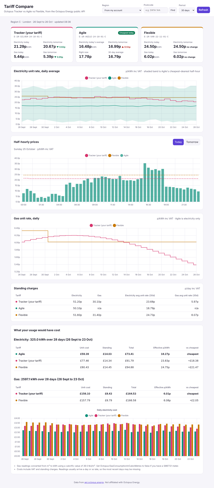

# Tariff Compare: Octopus Tracker vs Agile vs Flexible

An ASP.NET Core (.NET 8) web dashboard that uses the public [Octopus Energy API](https://developer.octopus.energy/) to:

- show today's and tomorrow's **Tracker** prices (electricity and gas) and how they moved
- chart Tracker against **Agile** (daily average plus cheapest/dearest half-hour band) and **Flexible**
- show today's and tomorrow's Agile half-hourly prices against the flat Tracker and Flexible prices
- compare standing charges
- price **your own smart-meter usage** under each tariff (needs your API key), showing what you would have paid on each



## Run it

You need the [.NET 8 SDK](https://dotnet.microsoft.com/download/dotnet/8.0).

```bash
cd octopus-dashboard/src/OctopusDashboard
dotnet run
```

Open http://localhost:5080. Prices work straight away with no login. Choose your region from the list, or type your postcode and press **Find**.

### Add your own usage (optional)

Get your API key and account number from octopus.energy → **Account → Personal details → API access**, then store them as user secrets so they stay out of source control:

```bash
cd octopus-dashboard/src/OctopusDashboard
dotnet user-secrets set "Octopus:ApiKey" "sk_live_..."
dotnet user-secrets set "Octopus:AccountNumber" "A-1234ABCD"
```

With these set, the app:

- reads your region and **your actual Tracker product** from your account (older Tracker versions have different product codes)
- downloads your half-hourly consumption and prices every half-hour under each tariff, including VAT and standing charges

You can also use the environment variables `Octopus__ApiKey` and `Octopus__AccountNumber`.

## Use it on your phone

The dashboard works well on a phone screen and can be added to your home screen, where it opens full-screen like an app.

**Set an access code first.** Once the app is reachable from your phone, anyone who finds its address could otherwise see your usage:

```bash
dotnet user-secrets set "Dashboard:AccessCode" "pick-a-long-passphrase"
```

You enter the code once on each device, and the phone then stays signed in for 90 days. Five wrong attempts in a minute lock out further attempts for that minute.

### Option A: over your home Wi-Fi (quickest, needs your computer on)

```bash
cd octopus-dashboard/src/OctopusDashboard
dotnet run --launch-profile Phone
```

1. Find your computer's local IP address: `ipconfig` on Windows, or `ipconfig getifaddr en0` on a Mac. It looks like `192.168.1.23`.
2. On your phone, connected to the same Wi-Fi, open `http://192.168.1.23:5080`.
3. Allow the app through your computer's firewall if it asks.

### Option B: host it online (works anywhere, free tier)

The `Dockerfile` runs on any host that builds Docker images, such as [Render](https://render.com), [Railway](https://railway.app), [Fly.io](https://fly.io) or Azure App Service. On Render, for example:

1. **New → Web Service**, connect this GitHub repository, and set **Root Directory** to `octopus-dashboard`. Render detects the Dockerfile.
2. Under **Environment**, add `Dashboard__AccessCode`, `Octopus__ApiKey` and `Octopus__AccountNumber` (note the double underscores).
3. Deploy, then open the `https://….onrender.com` address on your phone.

Free Render services sleep when idle, so the first visit after a while can take up to a minute to load. After each redeploy you'll be asked for the access code again.

### Add it to your home screen

- **iPhone (Safari):** tap Share → **Add to Home Screen**.
- **Android (Chrome):** tap ⋮ → **Install app** (or **Add to Home screen**).

Over HTTPS (Option B) it also shows the last prices it loaded when you're offline. Over plain `http://` on your Wi-Fi (Option A), the home-screen shortcut still works, but browsers turn off offline support.

## Settings (`appsettings.json`, section `Octopus`)

| Setting | Default | Notes |
|---|---|---|
| `DefaultRegion` | `C` | Region letter A–P, used when no account is configured |
| `TrackerProductCode` / `AgileProductCode` / `FlexibleProductCode` | blank | Leave blank to use the latest product on sale. Set one to pin a version, e.g. `SILVER-24-10-01` |
| `GasConsumptionInCubicMetres` | `true` | SMETS2 meters report gas in m³, SMETS1 in kWh. Set `false` for SMETS1 |
| `GasCalorificValue` | `39.5` | MJ/m³, used for the m³ → kWh conversion |
| `CacheMinutes` | `30` | How long API responses are cached in memory |

`Dashboard:AccessCode` (outside the `Octopus` section) turns on the sign-in page. Leave it blank only when the app runs on your own computer.

## How it works

```
wwwroot/ (HTML + Chart.js)  →  /api/dashboard  →  DashboardService  →  OctopusClient  →  api.octopus.energy
```

- `Services/OctopusClient.cs`: typed, cached client. Handles pagination, Basic auth (API key as username) and one retry on transient errors.
- `Services/DashboardService.cs`: picks the products, loads the rates and builds the charts and cost comparison.
- `Domain/RateTimeline.cs`: answers "what was the price at time t?" for any tariff shape. Daily averages are weighted across half-hours and handle the 46- and 50-slot clock-change days.
- `Domain/CostCalculator.cs`: prices the same complete days of usage under each tariff. A tariff with missing prices is flagged and never ranked as cheapest.

API endpoints the app exposes:

- `GET /api/dashboard?region=C&days=30`
- `GET /api/region?postcode=SW1A1AA`
- `GET /api/config`

## Tests

```bash
cd octopus-dashboard
dotnet test
```

## Notes

- Tracker prices for tomorrow are usually published in the evening, and Agile around 4pm. Until then they show as "not published yet".
- Smart-meter readings usually arrive about a day late. Costs cover only complete days.
- Agile is electricity only, so gas compares Tracker with Flexible.
- Chart.js 4.4.1 is bundled in `wwwroot/lib` (MIT licence), so the page loads no CDN scripts.
- Not affiliated with Octopus Energy.
